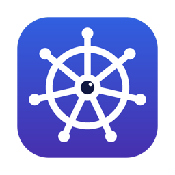

# Installing K-Vision

K-Vision is one program, `kv`: a desktop window (`kv ui`) and a terminal UI (`kv`) for every Kubernetes cluster
in your kubeconfig. Installing it needs **no admin rights**, and nothing is installed into your clusters.
<br clear="left">

**Before you start:** you need what `kubectl` already needs to reach your clusters -- a kubeconfig
(`~/.kube/config`) and, for EKS, the AWS CLI with a valid login (`aws sso login`). If `kubectl get nodes` works,
K-Vision works.

There are two ways to get it:

- **A. Download a release** -- the normal way, nothing to build.
- **B. Build it from this repository** -- for people working on K-Vision.

---

## A. Download a release

1. Open the **[latest release](https://github.com/jahangirov001/k-vision/releases/latest)** (or **Releases**
   on the right of the project page).
2. Take the newest release and download the file for your computer:

   | Your computer | File |
   |---|---|
   | Mac (Apple silicon or Intel), macOS 12 or newer | `K-Vision-<version>-macos.zip` (or `.dmg`) |
   | Windows 10 / 11, Intel or AMD | `K-Vision-<version>-windows-amd64.zip` |
   | Windows on ARM (Surface Pro X, Copilot+ PCs) | `K-Vision-<version>-windows-arm64.zip` |
   | Linux, Intel or AMD | `K-Vision-<version>-linux-amd64.tar.gz` |
   | Linux on ARM (AWS Graviton, Raspberry Pi 4/5) | `K-Vision-<version>-linux-arm64.tar.gz` |

   Not sure which Mac you have? It doesn't matter -- the one macOS file runs on both.
   Not sure about Windows? Settings → System → About → "System type": *x64* = amd64, *ARM-based* = arm64.

3. Follow the steps for your system below.

### macOS

**Install** -- in Terminal:
```sh
cd ~/Downloads
unzip K-Vision-*-macos.zip
cd K-Vision-*-macos
./install.sh
```
That puts **K-Vision** in Applications and the `kv` command on your PATH, and removes the "downloaded from the
internet" block. Open K-Vision from Spotlight or Launchpad, or run `kv ui`. Open a **new** Terminal window to use `kv`.

*No Terminal?* Double-click the `.dmg`, drag **K-Vision** onto **Applications**. The first time you open it,
macOS says it can't check the developer: **right-click** K-Vision → **Open** → **Open** (or System Settings →
Privacy & Security → **Open Anyway**). This is only needed once.

**Uninstall**
```sh
cd ~/Downloads/K-Vision-*-macos && ./install.sh --uninstall
rm -r ~/.k-vision        # optional: also delete settings and the audit log
```
(or drag K-Vision from Applications to the Bin, and `rm /usr/local/bin/kv`)

### Windows

**Install** -- in PowerShell (Start → type *PowerShell*); no administrator needed:
```powershell
cd $HOME\Downloads
Expand-Archive K-Vision-*-windows-amd64.zip -DestinationPath .
cd K-Vision-*-windows-amd64
powershell -ExecutionPolicy Bypass -File install.ps1
```
That puts `kv.exe` in `%LOCALAPPDATA%\K-Vision`, adds it to your PATH and adds **K-Vision** to the Start menu.
Open K-Vision from the Start menu. To use `kv` in a terminal, open a **new** one first.

The window opens in **Microsoft Edge** (or Chrome) as an app window of its own; Edge comes with Windows, so
nothing else is needed. If Windows SmartScreen warns about `kv.exe`: **More info → Run anyway** (the program
isn't code-signed).

**Uninstall**
```powershell
cd $HOME\Downloads\K-Vision-*-windows-amd64
powershell -ExecutionPolicy Bypass -File install.ps1 -Uninstall
Remove-Item -Recurse $HOME\.k-vision    # optional: also delete settings and the audit log
```

### Linux

**Install**
```sh
cd ~/Downloads
tar xzf K-Vision-*-linux-amd64.tar.gz
cd K-Vision-*-linux-amd64
./install.sh
```
`kv` goes to `~/.local/bin` (added to your PATH in `~/.bashrc` if it isn't already) and **K-Vision** appears in
your desktop's application menu. The window opens in Chrome, Chromium or Edge in app mode (or your default
browser). On a server without a desktop, the terminal UI `kv` works on its own.

**Uninstall**
```sh
cd ~/Downloads/K-Vision-*-linux-amd64 && ./install.sh --uninstall
rm -r ~/.k-vision        # optional: also delete settings and the audit log
```

### Check the download (optional)

Each release has a `SHA256SUMS` file. In the folder with the downloads:
```sh
shasum -a 256 -c SHA256SUMS --ignore-missing     # macOS / Linux
```
```powershell
Get-FileHash K-Vision-*-windows-amd64.zip        # Windows: compare with the line in SHA256SUMS
```

---

## B. Build from this repository

You need **Git** and **Go 1.27** or newer. On a Mac also the Xcode command line tools
(`xcode-select --install`) -- they build the native window.

```sh
git clone https://github.com/jahangirov001/k-vision.git
cd k-vision
./install.sh                 # macOS: builds and installs K-Vision.app + kv
                             # Linux: builds and installs kv
```
On Windows (PowerShell, with Go installed):
```powershell
git clone https://github.com/jahangirov001/k-vision.git
cd k-vision
powershell -ExecutionPolicy Bypass -File install.ps1
```
Uninstall the same way as above (`./install.sh --uninstall`, `install.ps1 -Uninstall`).

Other useful commands in the repository:

| Command | Does |
|---|---|
| `make test` | all tests (Go and JavaScript) |
| `make dist` | every release file into `dist/` (the Mac files only build on a Mac) |
| `kv --version` | the installed version |

---

## Updating

Install the new version exactly like the first time, over the old one. Your settings, removed clusters and the
audit log are kept. Then restart it: `kv restart` (on a Mac also K-Vision menu → **Restart K-Vision**).

## First start

Open K-Vision, pick a cluster, **Continue**. If a cluster shows *Login expired*, run `aws sso login` (or your
cluster's own login) and press **R** to refresh. `kv help` lists every terminal command and key.

---

## Making a release (maintainers)

Everything is built by GitHub Actions (`.github/workflows/release.yml`), including the Mac app, on GitHub's
Mac runners. Release files are attached to the **Releases** page and are never kept in git (`dist/` is ignored).

1. **Raise the version** in `internal/version/VERSION` (e.g. `1.0.7`), commit and push.
2. **Tag that commit** with the same number and push the tag:
   ```sh
   git tag 1.0.7 && git push origin 1.0.7
   ```
3. Watch it under **Actions → Release**. In about 10 minutes **Releases → K-Vision 1.0.7** has the Mac
   `.dmg`/`.zip`, the Windows and Linux packages and `SHA256SUMS`. If the tag and `VERSION` don't match, the run
   stops before publishing.

To try the build without publishing: **Actions → Release → Run workflow**. The files are then kept on that run
as a downloadable artifact.
