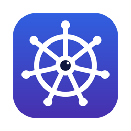
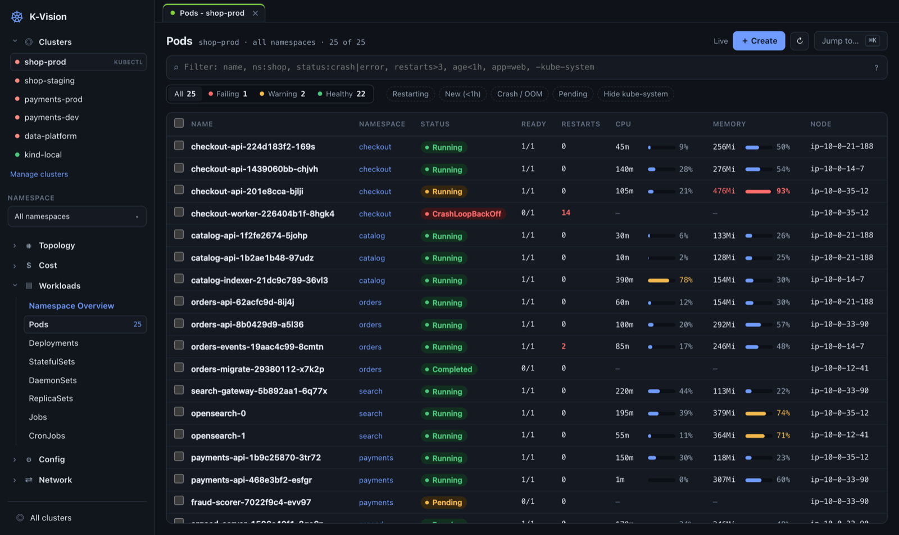
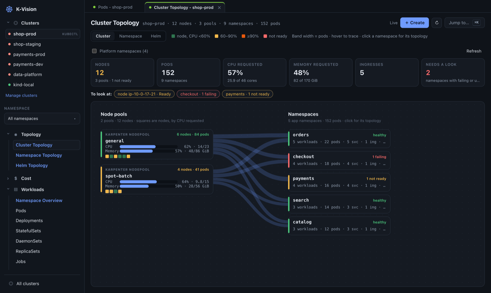
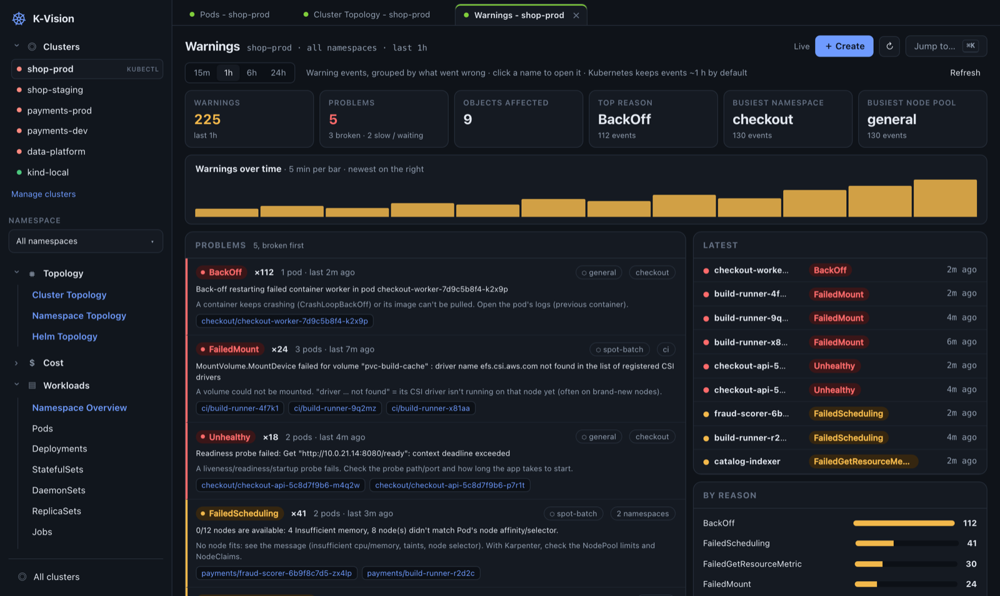
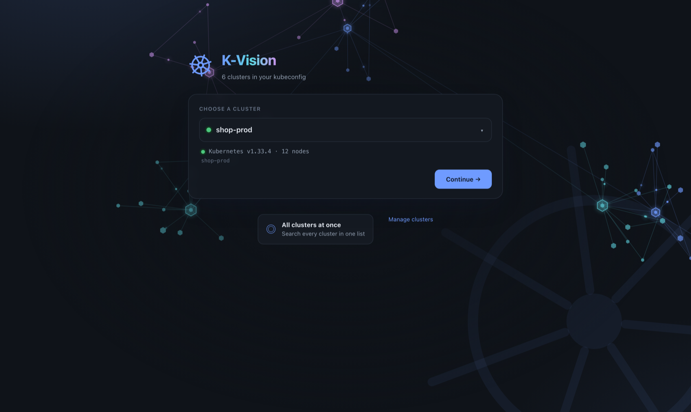
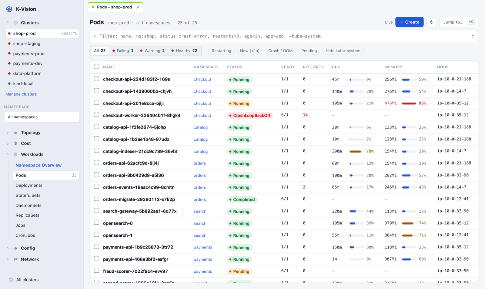

<p align="center">
  
</p>

<h1 align="center">K-Vision</h1>

<p align="center">
  <b>See every Kubernetes cluster you work with, in one place.</b><br>
  A desktop app and a terminal UI in one small program. Free, local, and no setup in your clusters.
</p>

<p align="center">
  <a href="https://github.com/jahangirov001/k-vision/releases/latest"><b>Download</b></a> ·
  <a href="INSTALL.md">Install guide</a> ·
  <a href="#what-you-can-do">Features</a> ·
  <a href="#keyboard">Keys</a>
</p>

<p align="center">
  
</p>

---

## What it is

K-Vision is one program, `kv`, with two ways to use it:

- **A desktop window** — like Lens. Click through clusters, read logs, open a shell, edit YAML.
- **A terminal UI** — like k9s. Fast, keyboard only, works over SSH.

Both read your kubeconfig exactly like `kubectl` does. **If `kubectl get pods` works, K-Vision works** — on EKS,
GKE, AKS, kind, minikube or anything else. Nothing is installed in your clusters, and nothing leaves your
computer except the calls to your own clusters.

## Install

Download the file for your computer from the **[latest release](https://github.com/jahangirov001/k-vision/releases/latest)**:

| Your computer | Download | Then |
|---|---|---|
| **Mac** (Apple silicon or Intel, macOS 12+) | `K-Vision-…-macos.dmg` | Open it, drag **K-Vision** to Applications. First time: right-click → **Open**. |
| **Windows 10 / 11** | `K-Vision-…-windows-amd64.zip` | Unzip, run `install.ps1` (see below). |
| **Linux** | `K-Vision-…-linux-amd64.tar.gz` | Unpack, run `./install.sh`. |

On Windows, in PowerShell inside the unzipped folder:

```powershell
powershell -ExecutionPolicy Bypass -File install.ps1
```

No admin rights are needed anywhere. **[INSTALL.md](INSTALL.md)** has every step, ARM builds, updating,
uninstalling and building from source.

## What you can do

<table>
<tr>
<td width="50%"></td>
<td width="50%"></td>
</tr>
<tr>
<td><b>Cluster Topology</b> — node pools, every node coloured by load, and which namespaces run where.</td>
<td><b>Warnings</b> — every warning in the cluster, grouped by problem, with what to check.</td>
</tr>
</table>

**Find problems fast**

- **All clusters at once.** One list of pods (or anything else) across every cluster in your kubeconfig.
  A cluster you can't reach is shown on its own line and doesn't block the rest.
- **"Why?" in plain words.** For a broken pod, K-Vision reads its status and events and tells you what's wrong:
  *not enough memory on any node*, *crash-looping, killed for using too much memory*, *can't pull the image*…
- **Warnings dashboard.** All warning events, grouped so 40 identical messages become one line, broken things
  first, with the node pool and a hint for what to look at.
- **Health at a glance.** Rows are green, amber or red; tabs count how many are failing.
- **Live CPU and memory** per pod, with a bar that turns amber at 70% and red at 90% of the limit.

**Work with resources**

- Logs (live, previous container, search, several pods merged in time order), shells into pods, and a root
  shell on a node.
- Edit YAML, create from templates (checked by the cluster before it's created), scale, restart, cordon, drain,
  port-forward, copy files to and from pods.
- Every resource type, including CRDs. Argo CD, Karpenter, KEDA and Helm get their own views and dashboards;
  Helm doesn't even need the `helm` command.
- **Cost** per namespace or workload, if the cluster runs OpenCost or Kubecost.

**Stay safe**

- Deleting or editing asks you to type the object's name. Deleting many at once on a real cluster asks you to
  type `delete`.
- Clusters on your own machine (kind, minikube, Docker Desktop…) are "safe" and ask less.
- Every change is written to an audit log at `~/.k-vision/audit.log`.
- The desktop window only talks to `127.0.0.1` and refuses requests from web pages.

<p align="center">
  
  
</p>
<p align="center"><sub>The start screen, and the light theme (it follows your system, or pick one in Settings).</sub></p>

## Getting started

1. Open **K-Vision** (Spotlight, Start menu or app menu), or run `kv ui` in a terminal.
2. Pick a cluster and press **Continue**.
3. Use the sidebar, or press **⌘K** (Ctrl+K) and type what you want: `pods`, `warnings`, `topology`, a cluster name…

Prefer the terminal? Run `kv`. `kv help` lists every command and key.

```sh
kv                          # pods in the current cluster
kv deploy                   # start on deployments
kv --context my-cluster nodes
kv ui                       # open the desktop window
```

## Filtering

Type in the filter box (or press `/`). Words are combined with AND.

| Type | To see |
|---|---|
| `api` | anything whose name, namespace, status or columns contain "api" |
| `!ok` | only things that aren't healthy |
| `ns:shop` | only the `shop` namespace |
| `status:crash\|error` | status contains "crash" or "error" |
| `restarts>3` · `age<1h` | more than 3 restarts · created in the last hour |
| `app=web` · `-kube-system` | label `app` is `web` · hide anything with "kube-system" |

## Keyboard

The same keys work in the window and the terminal.

| Key | Does | | Key | Does |
|---|---|---|---|---|
| `⌘K` / `:` | jump to anything | | `l` | logs |
| `/` | filter | | `s` | shell (pod or node) |
| `j` `k` | move down / up | | `x` | why is it unhealthy? |
| `Enter` | details / YAML | | `e` | edit |
| `1`–`4` | All / Failing / Warning / Healthy | | `Ctrl+D` | delete |
| `Space` | select a row | | `?` | all keys |

## Settings

Most things are in **Settings** (⌘,) in the app. A few can be set as environment variables before starting `kv`:

| Variable | Default | What it does |
|---|---|---|
| `KV_SAFE` | local clusters only | A regular expression of cluster names that should ask less before changes |
| `KV_AUDIT_LOG` | `~/.k-vision/audit.log` | Where changes are recorded |
| `KV_THEME` | follows the terminal | `light` or `dark` for the terminal UI |
| `KUBE_EDITOR` / `EDITOR` | `vi` | Editor for `e` in the terminal |

Your settings, the audit log and other data live in `~/.k-vision/`.

## Building from source

You need Go 1.27+ (and on a Mac, the Xcode command line tools: `xcode-select --install`).

```sh
git clone https://github.com/jahangirov001/k-vision.git
cd k-vision
make test        # run the tests
./install.sh     # build and install (Mac: the app + kv; Linux: kv)
```

How the code is organised:

```
cmd/kv           the program: terminal UI, or `kv ui` for the window
internal/kube    talking to clusters: resources, health, changes + audit log, logs, shells, explanations
internal/tui     the terminal UI
internal/web     the desktop UI: a local server and the page it serves
internal/window  the native macOS window
packaging        app icon and macOS app bundle
```

### Making a release

1. Put the new number in `internal/version/VERSION` (for example `1.0.7`) and commit it.
2. Tag the commit and push the tag:
   ```sh
   git tag 1.0.7 && git push origin 1.0.7
   ```

GitHub Actions then tests everything, builds the Mac app (universal), Windows and Linux packages, and publishes
them on the **Releases** page with a `SHA256SUMS` file. If the tag and `VERSION` don't match, nothing is
published.

## Good to know

- **The Mac app isn't notarized** by Apple, so the first time you open it macOS asks: right-click → **Open**.
  `install.sh` does this for you.
- **On Windows and Linux** the window opens in Edge or Chrome as an app window of its own. The terminal UI works
  everywhere.
- **Windows SmartScreen** may warn about `kv.exe` because it isn't code-signed: **More info → Run anyway**.
